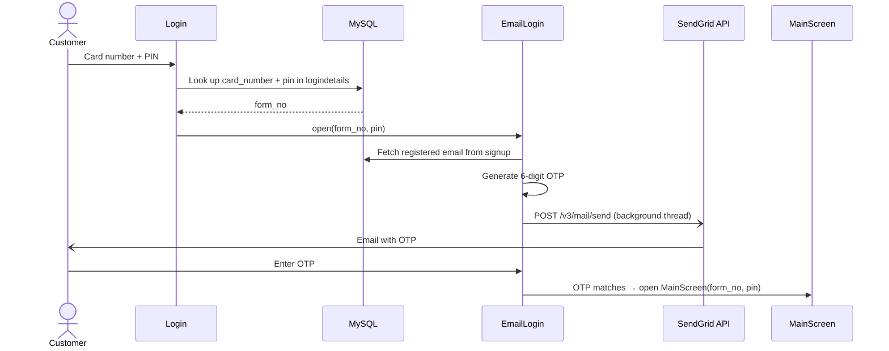
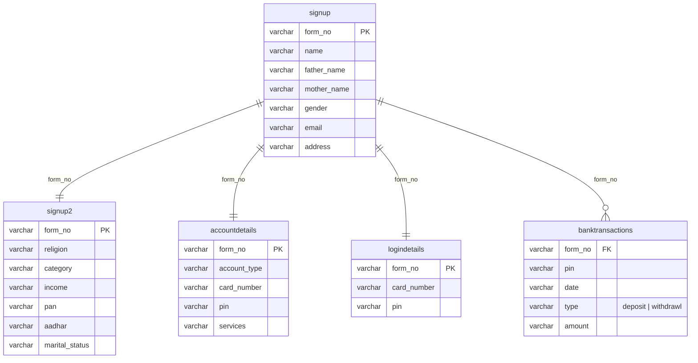

<div align="center">


<br>


**A desktop banking simulator that walks a customer from account opening to everyday ATM transactions,<br>with a 3-step KYC sign-up, email-OTP two-factor login, and a ledger-based transaction engine.**

[Features](#features) · [Screenshots](#screenshots) · [Architecture](#architecture) · [Getting Started](#getting-started) · [Database](#database-design) · [Roadmap](#roadmap)

</div>

---

## Overview

**Financial Management System** recreates the core workflows of a retail bank in a Java Swing desktop app backed by MySQL.

A new customer fills in a three-page application (personal details → KYC → account preferences), and the system issues a **16-digit card number and a 4-digit PIN**. A returning customer signs in with **two factors**: card number + PIN, then a **one-time password emailed to them** through the SendGrid API. From there, an ATM-style menu handles deposits, withdrawals, balance enquiries, mini statements and PIN changes.

Every deposit and withdrawal is written to an append-only ledger, and the balance is **always derived from that ledger** instead of being stored as a separate number that could drift out of sync.

## Features

| Feature | How it works |
|---|---|
| **3-step KYC onboarding** | `SignUp` → `SignUp2` → `SignUp3` collect personal details, PAN / Aadhaar / income / category, and account type + services. A random application number (`form_no`) ties every step together. |
| **Card & PIN issuance** | On submit, the app generates a 16-digit card number and a 4-digit PIN, saves them, shows them to the user and takes them straight to a first deposit. |
| **Two-factor login** | Factor 1: card number + PIN are checked against `logindetails`. Factor 2: a random 6-digit OTP is emailed via the **SendGrid v3 Mail API** and must match before the session opens. |
| **Non-blocking email** | The OTP request runs on a background thread with `java.net.http.HttpClient`, so the Swing UI stays responsive while the email is sent. |
| **Deposit** | Quick-amount buttons (₹2,000 / ₹5,000 / ₹10,000) or a custom amount; each deposit is logged as a timestamped `deposit` row. |
| **Cash withdrawal** | Computes the live balance first and blocks the withdrawal with *"Insufficient Balance"* if it would overdraw the account. |
| **Balance enquiry** | Balance = Σ deposits − Σ withdrawals, recalculated from the ledger every time. |
| **Mini statement** | Shows the card number masked as `8971XXXXXXXX4321`, a scrollable transaction history and the closing balance. |
| **PIN change** | Verifies the current PIN, requires the new PIN twice, then updates it across `logindetails`, `accountdetails` and `banktransactions`. |
| **Custom Swing UI** | Hand-laid-out `JFrame` screens with themed backgrounds and an ATM-style transaction hub. |

## Screenshots

> Captured from the running application with a demo account.

<table>
  <tr>
    <td width="50%"><p align="center"><b>Login</b>: card number + PIN</p></td>
    <td width="50%"><p align="center"><b>Email OTP</b>: second factor</p></td>
  </tr>
</table>

<table>
  <tr>
    <td width="33%"><p align="center"><b>Step 1</b>: personal details</p></td>
    <td width="33%"><p align="center"><b>Step 2</b>: KYC details</p></td>
    <td width="33%"><p align="center"><b>Step 3</b>: account setup</p></td>
  </tr>
</table>

<table>
  <tr>
    <td colspan="2"><p align="center"><b>Transaction hub</b>: ATM-style main menu</p></td>
  </tr>
  <tr>
    <td width="50%"><p align="center"><b>Deposit</b></p></td>
    <td width="50%"><p align="center"><b>Cash withdrawal</b></p></td>
  </tr>
  <tr>
    <td width="50%"><p align="center"><b>Balance enquiry</b></p></td>
    <td width="50%"><p align="center"><b>PIN change</b></p></td>
  </tr>
</table>

<p align="center">
  <br>
  <b>Mini statement</b>: masked card number and transaction history
</p>

## User Journey


## Architecture


The app follows a simple **three-tier** structure:

1. **Presentation (Java Swing).** Each screen is a `JFrame` that implements `ActionListener`. Screens pass the customer's `form_no` and PIN to each other in their constructors, so no global session state is needed.
2. **Data access (`Controller.java`).** Opens a JDBC `Connection` to MySQL and exposes a `Statement` that every screen uses to run its queries.
3. **Persistence (MySQL).** Five tables keyed by `form_no`, including an append-only `banktransactions` ledger.

An external **SendGrid** integration handles OTP delivery over HTTPS.

<details>
<summary><b>Login sequence (text version)</b></summary>


</details>

## Tech Stack

| Layer | Technology |
|---|---|
| Language | Java 11+ (uses `java.net.http`, lambdas) |
| GUI | Java Swing / AWT, absolute layout (`setBounds`) |
| Database | MySQL 8 / MariaDB 10.x |
| Connectivity | JDBC via MySQL Connector/J |
| Email / OTP | SendGrid v3 Mail Send REST API over `HttpClient` |
| IDE | IntelliJ IDEA (`Online_Banking_System.iml` included) |

## Project Structure

```
Financial-Mangement-System/
├── src/
│   ├── Bank/System/
│   │   ├── Login.java              # Entry point: card number + PIN (factor 1)
│   │   ├── EmailLogin.java         # Email OTP verification via SendGrid (factor 2)
│   │   ├── SignUp.java             # Sign-up step 1: personal details
│   │   ├── SignUp2.java            # Sign-up step 2: KYC (PAN, Aadhaar, income…)
│   │   ├── SignUp3.java            # Sign-up step 3: account type, card + PIN issuance
│   │   ├── Controller.java         # JDBC connection + Statement
│   │   └── BankFeatures/
│   │       ├── MainScreen.java     # ATM-style transaction hub
│   │       ├── Deposit.java
│   │       ├── Withdrawl.java
│   │       ├── BalanceEnquiry.java
│   │       ├── Statement.java      # Mini statement
│   │       └── PinChange.java
│   ├── Icon/                       # Logo and background images
│   └── Notes/                      # Developer to-do notes
├── assets/                         # README images & screenshots
└── Online_Banking_System.iml       # IntelliJ module file
```

## Getting Started

### Prerequisites

- **JDK 11 or newer**
- **MySQL 8** (or MariaDB 10.x) running on `localhost:3306`
- **MySQL Connector/J** JAR ([download](https://dev.mysql.com/downloads/connector/j/))
- *(Optional)* a **SendGrid** account with a verified sender, for real OTP emails

### 1. Clone the repository

```bash
git clone https://github.com/Ashwin-Laad/Financial-Mangement-System.git
cd Financial-Mangement-System
```

### 2. Create the database

Open the MySQL client (`mysql -u root -p`) or MySQL Workbench and run the script below. It creates the `Bank` database with the `signup`, `signup2`, `accountdetails`, `logindetails` and `banktransactions` tables.

<details>
<summary><b>Show the SQL script</b></summary>

```sql
-- ============================================================
--  Financial Management System — MySQL schema
--  Database name and credentials match Controller.java:
--    jdbc:mysql://localhost:3306/Bank   user: root
--
--  Column order matters: the application inserts with
--  positional VALUES(...), so keep columns in this order.
-- ============================================================

CREATE DATABASE IF NOT EXISTS Bank
    CHARACTER SET utf8mb4 COLLATE utf8mb4_unicode_ci;   -- amounts can contain "₹"
USE Bank;

-- Step 1 of sign-up: personal details (SignUp.java)
CREATE TABLE IF NOT EXISTS signup (
    form_no      VARCHAR(20)  NOT NULL,
    name         VARCHAR(100),
    father_name  VARCHAR(100),
    mother_name  VARCHAR(100),
    gender       VARCHAR(10),
    email        VARCHAR(120),          -- OTP is sent here at login
    address      VARCHAR(255),
    PRIMARY KEY (form_no)
);

-- Step 2 of sign-up: KYC & demographic details (SignUp2.java)
CREATE TABLE IF NOT EXISTS signup2 (
    form_no         VARCHAR(20) NOT NULL,
    religion        VARCHAR(20),
    category        VARCHAR(20),
    income          VARCHAR(10),
    pan             VARCHAR(10),
    aadhar          VARCHAR(12),
    marital_status  VARCHAR(12),
    PRIMARY KEY (form_no)
);

-- Step 3 of sign-up: account & services (SignUp3.java)
CREATE TABLE IF NOT EXISTS accountdetails (
    form_no       VARCHAR(20) NOT NULL,
    account_type  VARCHAR(40),
    card_number   VARCHAR(16),
    pin           VARCHAR(4),
    services      VARCHAR(100),
    PRIMARY KEY (form_no)
);

-- Credentials checked on the login screen (Login.java)
CREATE TABLE IF NOT EXISTS logindetails (
    form_no      VARCHAR(20) NOT NULL,
    card_number  VARCHAR(16) NOT NULL,
    pin          VARCHAR(4)  NOT NULL,
    PRIMARY KEY (form_no)
);

-- Append-only transaction ledger; balance = Σ deposits − Σ withdrawals
-- (Deposit.java, Withdrawl.java, BalanceEnquiry.java, Statement.java)
CREATE TABLE IF NOT EXISTS banktransactions (
    form_no  VARCHAR(20) NOT NULL,
    pin      VARCHAR(4),
    date     VARCHAR(40),               -- java.util.Date#toString()
    type     VARCHAR(10),               -- 'deposit' | 'withdrawl'
    amount   VARCHAR(20),               -- may include '₹'; stripped before parsing
    INDEX idx_tx_form (form_no)
);
```
</details>

### 3. Configure credentials

**Database** (`src/Bank/System/Controller.java`):

```java
connection = DriverManager.getConnection("jdbc:mysql://localhost:3306/Bank", "root", "");
//                                                                           user    password
```

**Email OTP** (`src/Bank/System/EmailLogin.java`):

```java
private static final String SENDGRID_API_KEY = "your-sendgrid-api-key";
// and set the "from" address to a sender verified in your SendGrid account
```

> **No SendGrid key? You can still test it.** The generated OTP is also printed to the console, so you can read it from your IDE's run window and enter it on the verification screen.

### 4. Run

**IntelliJ IDEA (recommended)**
1. Open the project folder.
2. *File → Project Structure → Libraries → + →* add the Connector/J JAR.
3. Mark `src` as the Sources root, then run **`Bank.System.Login`**.

**Command line** (put the Connector/J JAR in a `lib/` folder first)

```bash
# macOS / Linux
javac -encoding UTF-8 -cp lib/mysql-connector-j.jar -d out $(find src -name "*.java")
cp -r src/Icon out/
java -cp "out:lib/mysql-connector-j.jar" Bank.System.Login
```

```powershell
# Windows (PowerShell)
javac -encoding UTF-8 -cp lib\mysql-connector-j.jar -d out (Get-ChildItem -Recurse src -Filter *.java).FullName
Copy-Item -Recurse src\Icon out\
java -cp "out;lib\mysql-connector-j.jar" Bank.System.Login
```

> `-encoding UTF-8` matters: the source uses the `₹` symbol.

### 5. Try it out

1. Click **Sign Up** and complete the three steps.
2. Note the **card number and PIN** shown in the confirmation dialog, then make your first deposit.
3. Restart, sign in with the card number + PIN, enter the OTP, and explore the transaction menu.

## Database Design

All tables are linked by the application number **`form_no`** generated in step 1 of sign-up.



**Why a ledger?** There is no `balance` column anywhere. Every screen that needs a balance (Withdrawal, Balance Enquiry, Statement) recomputes it from `banktransactions`, so the transaction history and the balance can never disagree.

## Troubleshooting

| Problem | Fix |
|---|---|
| `Communications link failure` | MySQL isn't running on `localhost:3306`, or the credentials in `Controller.java` are wrong. |
| `Table 'bank.SignUp' doesn't exist` (Linux) | The code mixes table-name casing (`SignUp`, `signup`). Set `lower_case_table_names=1` in MySQL, or run on Windows/macOS where names are case-insensitive. |
| Background images missing | Copy `src/Icon` next to the compiled classes (IntelliJ does this automatically when `src` is a source root). File names are case-sensitive on Linux. |
| `₹` shows as `?` in amounts | Create the database with `utf8mb4` (as the setup script above does). |
| OTP email never arrives | Check the API key and that the *from* address is a verified SendGrid sender. Use the console-printed OTP while developing. |


## Contributing

Contributions, issues and suggestions are welcome.

1. Fork the repo
2. Create a branch: `git checkout -b feature/your-feature`
3. Commit your changes: `git commit -m "Add your feature"`
4. Push and open a Pull Request

## Author

**Ashwin Laad**: [@Ashwin-Laad](https://github.com/Ashwin-Laad)


---

<sub>Built as a learning project to explore desktop GUI development, relational database design and secure authentication flows in Java.</sub>
